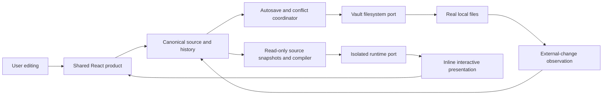

# Target architecture: shared product, local vault, isolated document runtime

Status: engineering target grounded in the owner's six setup answers of
26 November 2026. This defines responsibilities and gates, not proof that the
current host technology already satisfies them. [PRODUCT_CONTRACT](PRODUCT_CONTRACT.md)
is authoritative. Linux is first; web/mobile are future adapters, not certified targets.

## One product, explicit boundaries

The runtime has no edge to filesystem authority or canonical document mutation.
Input directed to a component controls its runtime state. A future editing contract
would be a separate editor-owned, revision-checked operation, not a privileged
message from arbitrary document code.

The product UI and application use cases depend on typed domain/platform ports.
Select adapters before initialization. Platform bootstraps may differ, but the
product tree, document model and interaction semantics must be shared. Do not
scatter whole-app `isTauri()` alternatives through the UI. Native dialogs/update
services can be platform capabilities within shared settings; a separate shell
or another note application is not an adapter.

Both the inline editor and whole-document presentation accept explicit trusted
runtime renderers rather than importing browser execution into their boundaries
([ADR-034](decisions/ADR-034-explicit-inline-runtime-renderer.md)). The actual
WebApp bootstrap supplies `WebRenderedRuntime` for islands and the stable
`WebDocumentRuntime` component for the whole document. `DocumentRuntime` delivers
its adapter session through a render prop: presentation, current diagnostics and
Stop/rebuild controls, without a mirrored runtime state or second source/history.
Absence is visibly unavailable, with no default browser hook or iframe fallback.

The web adapters retain the existing compiler/deadlines and sandbox policy.
Whole-document HTML still owns iframe identity: unchanged executable HTML retains
the frame across Source/Preview and theme changes, while retired requests withdraw
stale diagnostics and presentation. Stop/rebuild, island lifecycle and React-disable
reset retain their existing semantics. This extraction changes neither the product
UI nor native activation by itself. Subsequent shared-product and guarded
bootstrap integration is described below; these renderer boundaries do not
establish installed workspace or native runtime acceptance.

The existing document panels are extracted into `workspace/DocumentSurface.tsx`
([ADR038](decisions/ADR-038-shared-document-surface.md)). The host passes the
existing SourceEditor props and explicit runtime session; the leaf owns no
source copy, history, storage or native IPC. Mount/session identity is distinct
from logical path. This is a shared presentation leaf, not a completed shared
product root or native activation by itself. Controller-injected DOM tests and
real Store I/O remain separate evidence; installed typing-to-disk is still required.

## Current shared native composition

The native development entry now selects one window-lifetime guarded bootstrap
and the shared ProductRoot. ProductRoot composes actual shared navigation, header,
settings, palette and document interaction. NativeProduct delegates source/history
to existing DocumentSessions/SourceSession and filesystem operations to the scoped
NativeWorkspace; it adds neither a second document registry nor browser storage.

A synchronous trusted editor barrier precedes aggregate autosave/recovery draining
and exact native close acknowledgement. Only validated cancellation can return to
editing; unknown commit outcomes stay held. A permanent native fatal boundary
prevents reload/reinitialization of authority. See ADR039 and ADR041.

This is a candidate for installed real-file acceptance. Native React has no active
renderer adapter until the same-window input/containment gates pass. Missing
file lifecycle, restart recovery discovery, external observation and updater
integration remain explicit gaps rather than alternative product surfaces.

## Responsibilities

| Boundary                     | Owns                                                                                                                         | Must not own                                                                   |
| ---------------------------- | ---------------------------------------------------------------------------------------------------------------------------- | ------------------------------------------------------------------------------ |
| Shared document core         | Canonical raw source, revision identity, lossless patches, undo/redo, pending edits, module paths and source diagnostics     | Browser database, native IPC, rendered React state as source authority         |
| Shared application/use cases | Vault navigation, open/create/rename/move/Trash, autosave coordination, conflict/recovery state, commands and settings model | An independent platform-specific document model or silent persistence fallback |
| Shared React presentation    | Source/Preview, one document editing surface, navigation and plugin UI                                                       | Untrusted React execution with editor privileges                               |
| Vault port                   | Read/index/watch/write/create/rename/move/Trash/restore with revisions and scoped authority                                  | Arbitrary paths provided by document code                                      |
| Runtime port                 | Compile snapshots, present isolated inline components, route bounded interaction, report termination/error/lifecycle         | File, shell, editor IPC or document-edit authorization                         |
| Core plugin registry         | Trusted built-in Markdown/math/React capabilities and settings                                                               | Community package execution or undocumented privileges                         |
| Platform services            | File chooser/capability grants, lifecycle, appearance persistence, diagnostics and signed updater where supported            | Product forks or hidden note-content uploads                                   |

## Local vault persistence

Keep document identity, editor revision and disk revision distinct. A view/callback
is bound to its document identity, not whichever note is currently selected. An
accepted source patch validates the expected editor revision and advances it;
undo/redo are new accepted revisions, not permission to reuse a stale mapping.
A write carries the exact source/editor revision and expected disk revision. Its
acknowledgement records only that written version; newer edits remain pending.
Identical bytes alone do not establish identical history or literal-dollar intent.
Publish the accepted source witness before dependent projections refresh, without
discarding late edits belonging to a different still-existing document.

The selected folder is the source of truth. Index inventory separately from loaded
text and the compiler dependency graph; a 32-source bundle budget must not become
a 32-note vault limit. Root-relative identities and path normalization need one
consistent policy across navigation, imports, history and filesystem operations.

Every accepted edit schedules an asynchronous atomic save immediately. Maintain
one in-flight write and the latest pending revision per document; coalesce
superseded work rather than issuing conflicting parallel writes. Acknowledgement
advances the persisted baseline only for the bytes actually written. Later input
stays pending. Compilation failure never prevents source persistence.

Watch external changes and distinguish self-writes using revision/content
witnesses. Detect conflicts before overwrite. Reconcile safe changes or ask for
explicit resolution without discarding either version. Close/upgrade must flush
pending writes or show a truthful failure state; never silently claim durability.
Preserve permissions, BOM, EOLs and unrelated bytes. Recovery protects failed or
unapplied edits internally; it is not a replacement save workflow.

Create notes as real files in the vault with collision-safe names. Rename/move/Trash
operate on real files and must account for references and restoration collisions.
Design multi-file reference updates explicitly; do not rewrite arbitrary JSX or
imports through broad string substitutions. User interaction authorizes these
operations through trusted app use cases; author React remains unprivileged.

Metadata/preferences may use versioned local auxiliary files. Do not replace note
content with opaque database records. Restoring workspace context must revalidate
capabilities/identities; remembering a pathname is not unlimited filesystem access.
No default browser workspace or remote backend substitutes for the local vault.

## Runtime feasibility gate: mandatory before promising native parity

The owner requires interactive React in the same document/window. Existing native
supervision opens a separate window, so presentation/embedding is unresolved.
Investigate actual embedding/compositing, input, focus, scrolling, sizing and
accessibility while preserving process/profile/cgroup ownership and denial of IPC,
filesystem and unauthorized network access. Whole-document runtime and inline
islands now have explicit renderer seams with browser adapters. Both still need
validated native adapters; extracting those browser dependencies does not prove
native embedding or containment.

Prove the relevant renderer PID/process tree and fixed aggregate resource limits;
multiple islands must not silently multiply budgets. Stop must terminate execution
and descendants while the editor and disk saving remain usable. Current expiry,
CPU/memory policies and unresolved renderer/Stop observations are not silently
relaxed for UX. Document the proposed lifecycle and prove its security implications.

Reuse the current Tauri/native machinery if it fits. If it cannot meet the contract,
compare a narrowly scoped alternative host/renderer using the same threat model
and the same shared product; do not implement two new applications. Technology
selection is an engineering decision supported by evidence, not a library vote
for the owner. An isolated feasibility harness is not a deliverable application.
If evidence is unavailable or the requirement cannot be met, mark that milestone
blocked and continue safe independent work without declaring native parity.

The dated [actual-Wry diagnostic](security-evidence/2026-11-26-wry-inline-spike/README.md)
provides partial X11 presentation evidence: GTK Socket/Plug with Wry's GTK builder
painted a fixed fixture under the unchanged Supervisor. Raw `build_as_child`
remained black. Interaction, React and full geometry/lifecycle/security are not
proved; do not repeat the raw-window hypothesis as if no investigation occurred.
The subsequent [input diagnostic](security-evidence/2026-11-26-wry-input-spike/README.md)
observed script readiness, real pointer interaction and a verified-live pre-expiry
Stop. Normal keyboard focus remains unproven; forced-focus typing is only a
diagnostic. The next narrow proof must stage normal field focus before keyboard
input, then actual React, without changing the resource contract.

The [staged normal-focus follow-up](security-evidence/2026-11-26-wry-normal-focus-spike/README.md)
missed its predeclared 44-second script-ready window, sent no component input and
ran no React case. Valid targeted Stop completed in 0.83 seconds. The same artifact
had earlier interacted, but the observer/environment differ; neither result proves
repeatable readiness. CPU/journal and post-case load data do not establish a cause.
Do not extend the lifetime or replay cold boots without a new discriminating
hypothesis. Shared editor/controller work can proceed while this gate stays open.

The [actual MDX/React pointer case](security-evidence/2026-11-26-wry-react-pointer/README.md)
subsequently mounted hooks/state and reached Count 2 through OS clicks. It is
functional evidence only: the guest's writable synthetic share contained its
task-local SSH transport key, contrary to the no-share plan. The fixture/key was
removed; no owner credentials or notes were involved. VM/security acceptance is
excluded. Its Stop observer also aborted with ESRCH, so bounded cleanup was not
proved. Do not infer integrated application, keyboard or full sandbox readiness.
Correct and review provisioning before further native runtime work.

Browser iframe containment is not proof of native CPU/memory control. Actual
installed Linux/WebKitGTK or the selected replacement host must pass real runtime
acceptance in a disposable environment. Browser IPC mocks remain separate evidence.

## Existing-code fit assessment

These are initial engineering assessments, to verify with implementation tests:

| Existing area                                                        | Candidate treatment                                          | Reason                                                                                                                    |
| -------------------------------------------------------------------- | ------------------------------------------------------------ | ------------------------------------------------------------------------------------------------------------------------- |
| SourceEditor, raw source/history, source-preserving patch engine     | Reuse/adapt                                                  | Strong relevant behavior and fixtures; protect exact bytes and stale-source checks.                                       |
| Math/core plugins and compiler virtual-module pipeline               | Reuse/adapt                                                  | Already solve real authoring; decouple platform/runtime assumptions and retain package restrictions.                      |
| Native descriptor-based file writer, grants, revision/conflict tests | Reuse/adapt                                                  | Valuable data-safety mechanisms; extend for vault inventory/watch/creation and autosave semantics.                        |
| WebApp/useWebWorkspace                                               | Extract compatible presentation/use cases; refactor coupling | Browser storage, virtual metadata and runtime initialization do not form the required local-vault architecture unchanged. |
| NativePreview/supervisor and custom Wry work                         | Retain evidence; validate fit                                | Process supervision is useful, but a separate window does not meet inline presentation.                                   |
| Legacy App/NativeWorkspaceShell as product routes                    | Retire from product after migration acceptance               | Rejected parallel interfaces; keeping internal test evidence does not authorize shipping them.                            |

Do not delete working source/data or historical evidence as a setup shortcut.
Architecture quality governs reuse; neither wholesale preservation nor wholesale
replacement is presumed. Record each actual reuse/refactor/replace decision with
its contract IDs, dependencies and acceptance evidence.

## Open engineering risks

- Inline native runtime with proven containment is a product/security blocker.
- Autosave, external writers, permission failures and multi-file operations are
  data-safety work, not just changes to a Save button.
- Virtual browser folders/IDs/attachments/Trash must not silently become incorrect
  filesystem semantics. Map capabilities deliberately before activating controls.
- React state reuse must follow actual code/dependency witnesses, not generic
  reverse serialization of arbitrary component state.
- Browser/mobile file permissions and lifecycle differ. Unsupported capabilities
  must be truthful; no silent browser-storage fallback or untested platform claim.
