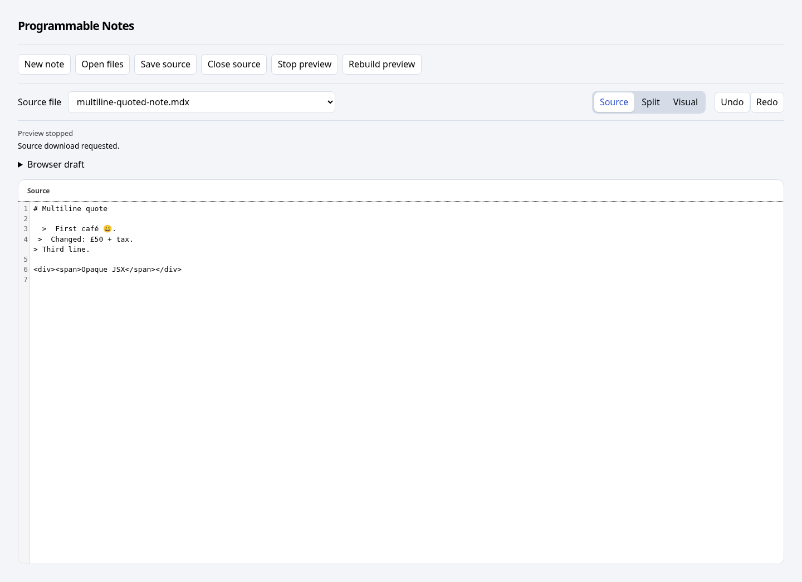
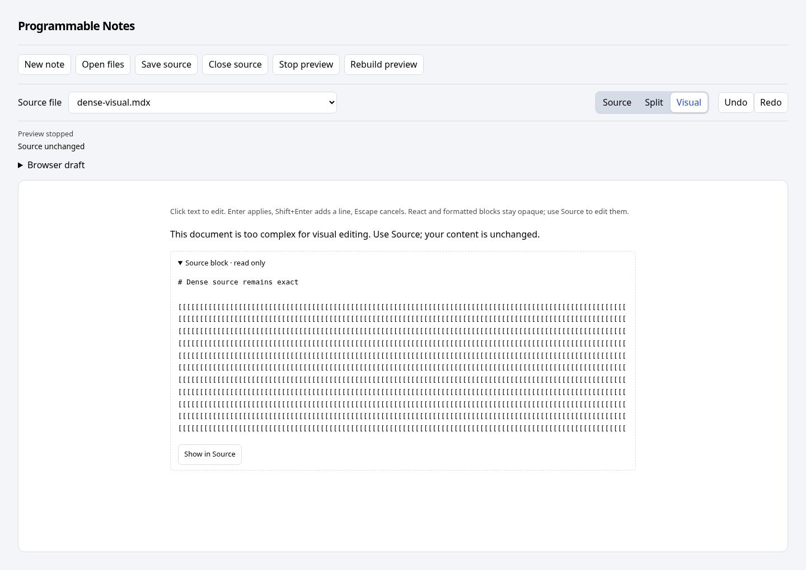
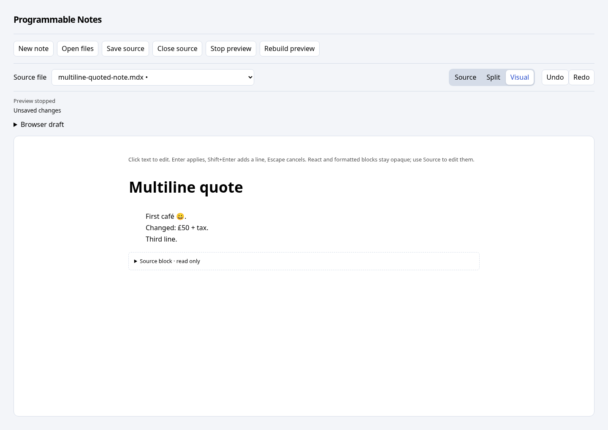

# Downloadable editor review

[Download the current browser review ZIP](https://github.com/TomasDelon/programmable-notes/blob/16e8a3a09d33e05b57dbe1992eb25dc1c3c8ee84/docs/demo/programmable-notes-review-2026-11-19.zip?raw=true)
(10,984,209 bytes).

The application source is `54c41a7`; these delivery-tool changes do not change
its frontend. The ZIP contains a complete browser build, a 27.64-second
1440 × 1000 walkthrough, 23 PNG files (20 shown in the walkthrough), desktop/tablet/
mobile before/after modes and seven actual MDX exports. The navigation export
intentionally preserves the already-edited quote document unchanged. PR #1 stays
draft; this is a review attachment, not a public release.

Extract into a new directory. Open `walkthrough/walkthrough.html` for video and
screenshots. To use the working editor, run in `browser-build`:

```sh
python3 -m http.server 8000 --bind 127.0.0.1
```

Open <http://127.0.0.1:8000> in Chromium; Node/npm is unnecessary. Source authoring,
interactive isolated React, trusted visual Markdown edits, per-document history,
exact source exports and browser drafts are working. Enter applies visual text;
Escape cancels; Ctrl/Cmd+S exports from the trusted workspace. Unapplied text is
memory-only until applied. Source changes restart React; mode changes preserve it.

The recording also demonstrates exact multiline quote prefixes/endings, refused
structural edits with pending input retained, **Show in Source** for opaque JSX,
and a conservative dense-document read-only fallback without changing source.
The fallback is not a universal parser deadline. JSX stays opaque in the trusted
editing surface; arbitrary React reverse editing is unsupported.

SHA256: `0d802c849718fa6ab5e36c3a1e8af69ffe42ab0d58743e54061bc8404e1cea26`.

Actual clean-extracted browser checks passed the earlier editing/React/offline/
pending/history/source-fidelity cases plus Source focus/unchanged export and dense
readonly/exact export. Exact caret insertion remains covered by the repository's
end-to-end tests. Local-file playback decoded frames without error; all 20 embedded
images loaded. Full repository check passed 88 unit and 34 Chromium tests. Manifest/CRC
and nine malformed-artifact rejection controls passed. [Raw evidence and scope](../security-evidence/2026-11-19-engine54-review/README.md).









Native filesystem permissions, WebKitGTK, recovery and cgroups have separate
Linux acceptance procedures. No native installer is included. Browser CPU/memory
quotas and production security readiness are not claimed. The later bounded-observer native six-case run passed all six cases; earlier
instant-observer and OOM/startup failures remain retained. This does not establish
why the earlier instantaneous PID observation occurred or fix the underlying
renderer/startup crashes. [Current native evidence](../security-evidence/2026-11-19-bounded-cleanup/README.md).

Regenerate with a fresh production build on loopback port 4188, then
`node scripts/demo-editor.mjs`, `python3 scripts/package-review-demo.py` and
`python3 scripts/verify-review-demo.py --browser`. `DEMO_URL` selects another
loopback port. CI can upload the unpacked `playable-editor-demo` on an explicit
workflow dispatch with `review_artifacts` enabled (seven-day retention). Normal PR
CI retains browser testing and avoids recording the demo on every push. In Codex Cloud, system Chromium is selected with
`PLAYWRIGHT_CHROMIUM_EXECUTABLE_PATH=/usr/bin/chromium`; matching downloaded
Playwright uses `PLAYWRIGHT_BROWSERS_PATH=/workspace/.cache/ms-playwright` with the
executable override unset.

[Previous immutable engine 34dc906 review](https://github.com/TomasDelon/programmable-notes/blob/247ee9a1de67c027a032ee1ba162fd03714611ba/docs/demo/programmable-notes-review-2026-11-19.zip?raw=true)
and its [remote receipt](../security-evidence/2026-11-19-multiline-review/raw/remote-download.json)
remain historical. The current remote Git blob was downloaded and matched every byte. [Current download receipt](../security-evidence/2026-11-19-engine54-review/raw/remote-download.json).

## Redistribution notices

Retain [THIRD_PARTY_NOTICES.txt](THIRD_PARTY_NOTICES.txt) alongside the historical
ZIP above. It contains full upstream texts for the installed production npm
dependencies and direct build tools. The historical demo engine `54c41a7` and the
current notice inventory use identical dependency lockfiles. The original archive
and checksum remain unchanged as evidence. New builds generate the notices into
the build, and the packager refuses to assemble a demo without them. These
notices do not assign a license to Programmable Notes or establish rights in the
supplied design/research. See [public remediation](../PUBLIC_READINESS.md).

The sidecar now also supplies the embedded Go runtime/standard-library notices
missing from esbuild-wasm's npm MIT file. The historical demo's actual WASM SHA256
was verified identical to the pinned current asset. New builds reject compiler
version/asset/notice mismatches until attribution is reviewed. See the
[embedded attribution inventory](../../licenses/README.md).
