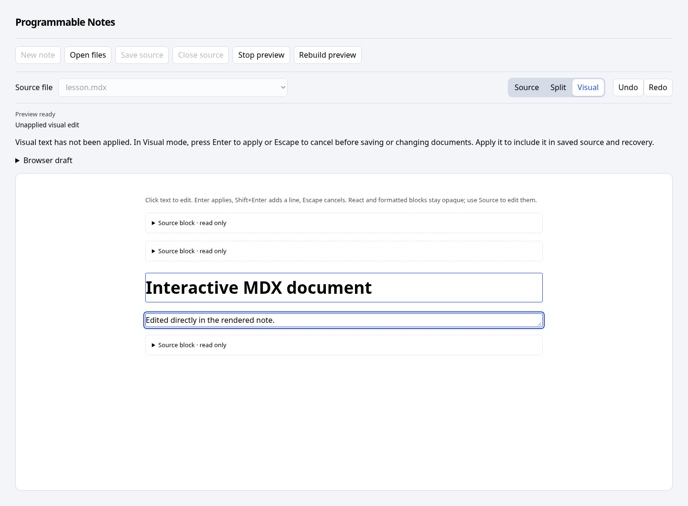
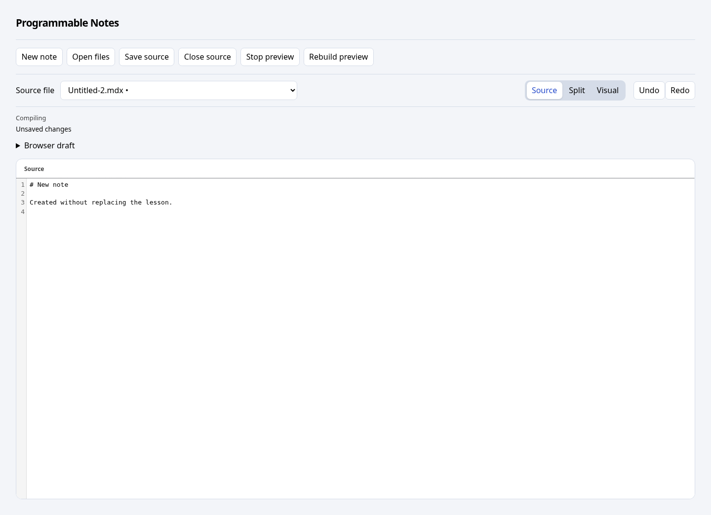
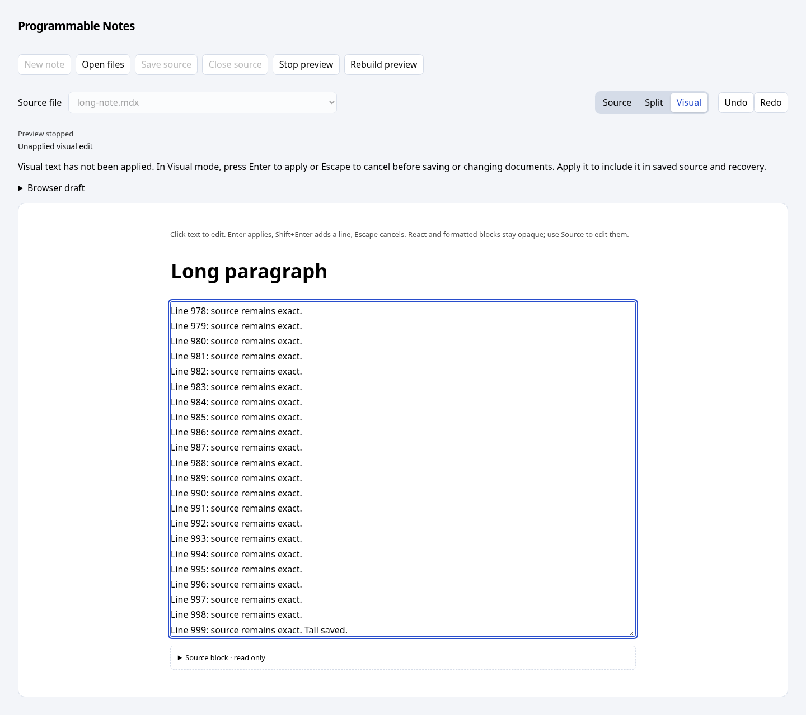
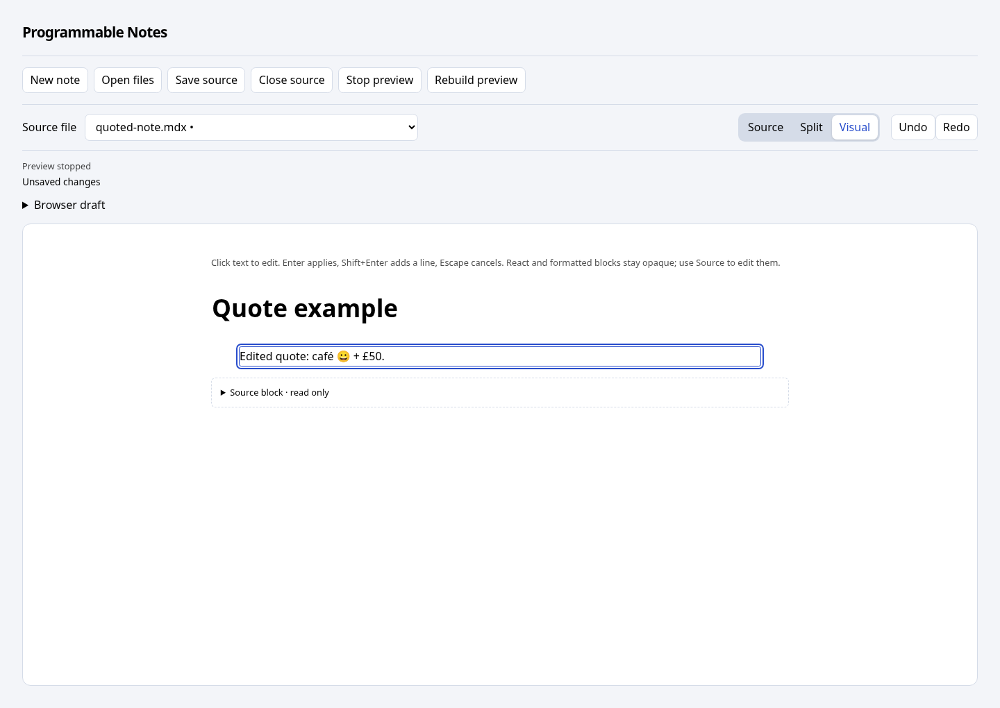
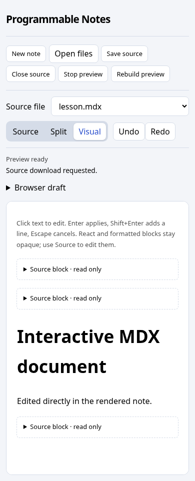

# Downloadable editor review

[Download the working review ZIP](programmable-notes-review-2026-11-19.zip?raw=true)
(7,075,909 bytes).

This dated ZIP is the requested PR-accessible review attachment while hosted
Actions refuses jobs because of account billing. It contains a complete browser
build, a recorded walkthrough, before/after screenshots at desktop/tablet/mobile
sizes and all four actual saved MDX files. The source application is from `f503644`;
these delivery-tool changes do not change its frontend. The PR remains draft.

Extract into a new directory. Open `walkthrough/walkthrough.html` for the video
and screenshots. To use the editor, open a terminal in `browser-build` and run:

```sh
python3 -m http.server 8000 --bind 127.0.0.1
```

Open <http://127.0.0.1:8000> in Chromium. Node/npm is unnecessary for this packaged
browser build. Browser Save exports an MDX download. Focus Source, Visual or the toolbar and
use Ctrl/Cmd+S. In Visual mode, Enter applies and Escape cancels; apply pending
text before saving. Unapplied text is memory-only until applied. Native file permissions,
WebKitGTK, recovery and cgroups have separate Linux acceptance procedures.
Browser CPU/memory quotas and production security readiness are not claimed.

SHA-256: `89c78c59b4728e137ee7a8f1a2df7ac58230c0f208fc9a4b294bd5cd2b155959`

The clean extracted package passed real React interaction, a new focused note,
exact keyboard-exported bytes, protected unapplied text, BOM/CRLF/opaque JSX
preservation, exact mixed internal breaks, ambiguous-edit refusal, accurate selected status with a dirty sibling, offline recompilation after initial loading, and end typing in a bounded thousand-line input with exact export, and literal quote edits retaining indentation, markers, Unicode and CRLF. Final repository checks passed
65 unit and 30 Chromium tests. The packager verified a complete asset/capture hash
manifest and CRC; eight negative fixtures rejected changed/missing/extra assets,
changed captures, unsafe paths, symlinks and failed recordings. The ZIP contains
its manifest and capture receipt. [Raw checks and scope](../security-evidence/2026-11-19-quote-review/README.md).













Regenerate from the repository with a fresh production build, serve it on loopback
port 4188, then run `node scripts/demo-editor.mjs`,
`python3 scripts/package-review-demo.py`, and
`python3 scripts/verify-review-demo.py --browser`. In Codex Cloud set
`PLAYWRIGHT_CHROMIUM_EXECUTABLE_PATH=/usr/bin/chromium` and
`PLAYWRIGHT_BROWSERS_PATH=/workspace/.cache/ms-playwright`. `DEMO_URL` can select
another available loopback port. CI runs these checks and uploads the unpacked
package as `playable-editor-demo` when runners become available.

Mixed internal LF/CRLF word edits now preserve bytes. Ambiguous changes to the
number of mixed breaks are conservatively refused, retaining entered text; use
Source for those structures. Exact outside spans and undo history remain intact.
