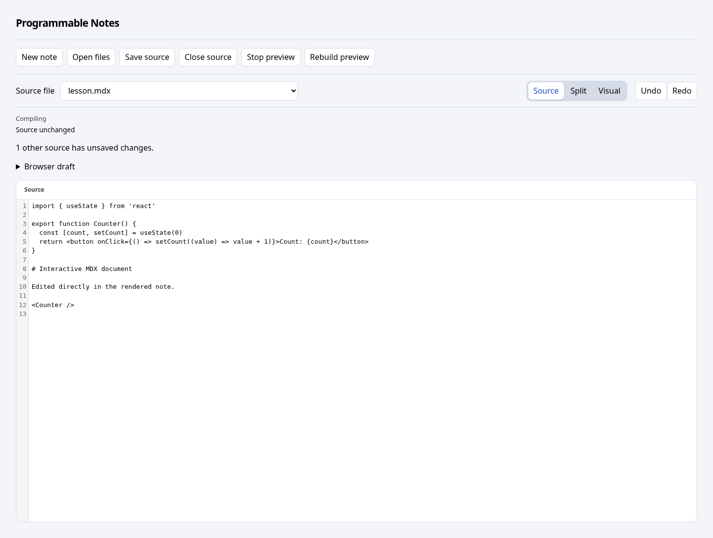
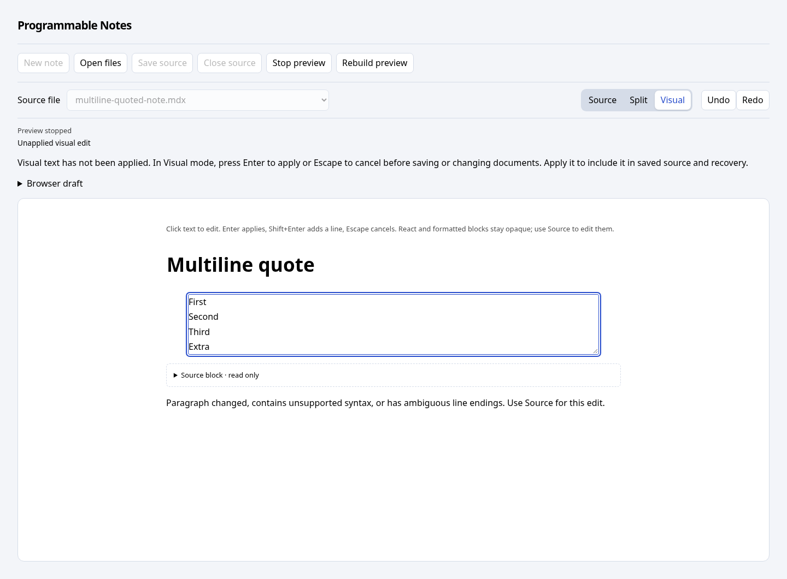

# Downloadable editor review

[Download the working review ZIP](https://github.com/TomasDelon/programmable-notes/blob/247ee9a1de67c027a032ee1ba162fd03714611ba/docs/demo/programmable-notes-review-2026-11-19.zip?raw=true)
(8,540,754 bytes).

This dated ZIP is the requested PR-accessible review attachment while hosted
Actions refuses jobs because of account billing. It contains a complete browser
build, a recorded walkthrough, before/after screenshots at desktop/tablet/mobile
sizes and all five actual saved MDX files. The source application is from `34dc906`;
these delivery-tool changes do not change its frontend. The PR remains draft.

Extract into a new directory. Open `walkthrough/walkthrough.html` for the video
and screenshots. To use the editor, open a terminal in `browser-build` and run:

```sh
python3 -m http.server 8000 --bind 127.0.0.1
```

Open <http://127.0.0.1:8000> in Chromium. Node/npm is unnecessary for this packaged
browser build. Browser Save exports an MDX download. Focus Source, Visual or the toolbar and
use Ctrl/Cmd+S. In Visual mode, Enter applies and Escape cancels; apply pending
text before saving. Unapplied text is memory-only until applied. Native file permissions,
WebKitGTK, recovery and cgroups have separate Linux acceptance procedures.
Browser CPU/memory quotas and production security readiness are not claimed.

SHA-256: `ccc780298173df68c25612d56989f0560889c1f0ee58e8dc1bd6c0995cd3febb`

The clean extracted package passed real React interaction, a new focused note,
exact keyboard-exported bytes, protected unapplied text, BOM/CRLF/opaque JSX
preservation, exact mixed internal breaks, ambiguous-edit refusal, accurate selected status with a dirty sibling, offline recompilation after initial loading, and end typing in a bounded thousand-line input with exact export, literal quote edits retaining indentation, markers, Unicode and CRLF, plus explicit multiline quotes with mixed endings and unsafe line-count retention. Final repository checks passed
75 unit and 31 Chromium tests. The packager verified a complete asset/capture hash
manifest and CRC; nine negative fixtures rejected changed/missing/extra assets,
changed captures, unsafe paths, symlinks and failed recordings. The ZIP contains
its manifest and capture receipt. [Raw checks and scope](../security-evidence/2026-11-19-multiline-review/README.md).








Regenerate from the repository with a fresh production build, serve it on loopback
port 4188, then run `node scripts/demo-editor.mjs`,
`python3 scripts/package-review-demo.py`, and
`python3 scripts/verify-review-demo.py --browser`. In Codex Cloud set
`PLAYWRIGHT_CHROMIUM_EXECUTABLE_PATH=/usr/bin/chromium` and
`PLAYWRIGHT_BROWSERS_PATH=/workspace/.cache/ms-playwright`. `DEMO_URL` can select
another available loopback port. CI runs these checks and uploads the unpacked
package as `playable-editor-demo` when runners become available.

Mixed internal LF/CRLF word edits now preserve bytes. Ambiguous changes to the
number of mixed breaks are conservatively refused, retaining entered text; use
Source for those structures. Exact outside spans and undo history remain intact.

Explicit multiline quoted paragraphs may change text while retaining line count.
Every continuation marker and physical ending remains exact; use Source to change
structure. Native session feedback and Stop retry are implemented in the source
engine, but this browser attachment does not exercise native functionality.

The exact remote Git blob was downloaded and matched every byte; its immutable
link above is pinned to the verified delivery commit. [Download receipt](../security-evidence/2026-11-19-multiline-review/raw/remote-download.json).
