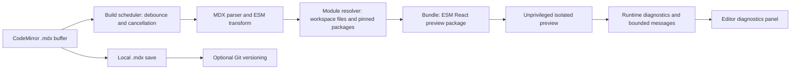

# Engineering Proposal: MDX Compiler and Live Preview

## Distinguish app build from document build

- **Application build:** Vite compiles the Programmable Notes UI and packaged assets.
- **Document build:** at runtime, a changing/possibly unsaved `.mdx` buffer is parsed and compiled, its imports resolved, output bundled/transformed, and the result loaded in the preview.
- These pipelines may reuse tools, but successful Vite HMR for checked-in files does not prove the runtime buffer pipeline.

## Proposed data flow

## Candidate A: esbuild plus official MDX integration

- For the **cloud Node prototype**, use `esbuild`'s async JavaScript API with `@mdx-js/esbuild`, or an explicit `@mdx-js/mdx.compile` phase followed by esbuild ESM bundling; test which integration handles virtual unsaved `.mdx` entries cleanly.
- Compile/bundle React, imported local `.tsx` files and explicit package dependencies from a controlled workspace. Use locked dependency versions. Disallow import paths that escape the workspace.
- Build from an in-memory virtual module with a deterministic *logical file path* for resolving relative imports. Output ESM, `write:false`, and a source map. Ensure no host code is executed as a side effect of compilation plugins.
- React and ReactDOM must not be accidentally duplicated in the preview; verify hooks work without invalid-hook errors.
- `esbuild` is written in **Go**, not Rust. `esbuild-wasm` is a separate browser-side option to evaluate for Tauri/web packaging.
- Drawback: the Node-based esbuild API working in Codex Cloud does not mean the identical runtime exists inside a shipping Tauri binary.

## Candidate B: Vite virtual modules or dev-server processing

- Serve the editor buffer as an in-memory virtual module and trigger its invalidation/reload. Wire local imports through Vite's module graph and transformations.
- Advantage: strong familiar dev tooling, ecosystem import resolution and React Fast Refresh during development.
- Drawback: packaged runtime cannot require users to run a developer server. A deployable alternative must be identified, with offline tests.

## Engineering recommendation

1. Use **Candidate A** for the initial browser/cloud spike because it can be exercised deterministically from tests. Treat this as a PROTOTYPE CHOICE, not a locked packaged-app architecture.
2. Also run a minimal `esbuild-wasm` + MDX experiment in a Web Worker to assess web and packaged desktop feasibility. Preserve any failing fixture in the repository.
3. If the worker path cannot satisfy offline imports and performance, document a tightly scoped native compilation service/sidecar alternative without granting preview code filesystem or shell privileges.
4. Compile only on edits (debounced), invalidate stale results, display errors with the source location, and ensure an error cannot destroy source or crash the editing shell.
5. Preview loading must honor the SECURITY_MODEL.md; never load untrusted generated modules directly in the privileged React editor tree.

## Compiler acceptance fixtures

- `samples/fixtures/counter.mdx`: inline React component with `useState`, event handler and visible count.
- `samples/fixtures/imported-counter.mdx` + `samples/fixtures/widgets/ImportedCounter.tsx`: relative TSX import.
- `samples/fixtures/invalid.mdx`: recoverable compiler error.
- External package fixture using one lockfile-pinned third-party package, chosen by implementer.
- Later: source maps, hot replacement policy, compilation cancellation, offline mode, and stale build race.

## Diagnostics and runtime

Record errors with source file, line/column, message, and build ID. Keep the raw text in CodeMirror unchanged. Decide whether preview retains last valid render or displays an error panel; either must clearly show the failure state. Never silently show stale content as if it were current.

## Official references

- https://mdxjs.com/packages/mdx/
- https://mdxjs.com/packages/esbuild/
- https://mdxjs.com/packages/rollup/
- https://esbuild.github.io/plugins/
- https://esbuild.github.io/api/
- https://vite.dev/guide/api-plugin
