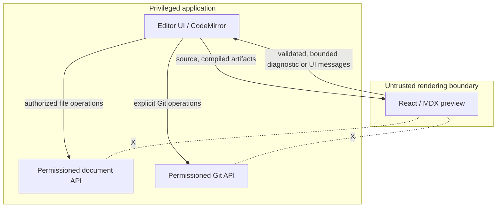

# Security Model: Author-Provided MDX/React

**Classification:** Design proposal awaiting tests. There has been no security review or verified sandbox implementation in this handoff.

## Assets and adversary

Assume an opened `.mdx` note, imported `.tsx` module, npm dependency or AI-generated component may be malicious. Protect (1) host filesystem and private workspace files, (2) GitHub/API tokens and accounts, (3) native OS commands and processes, (4) other open notes and editor state, (5) network access/exfiltration, (6) application responsiveness and user's unsaved edits.

## Privilege boundaries

An isolated preview may be a sandboxed cross-origin iframe or a separate restricted webview/process. **Do not interpret the diagram as an implementation/security guarantee.** Cross-origin and capability restrictions must be tested in the actual target WebView.

## V1 policy

1. Compile author code only in a controlled compiler service; no arbitrary plugin loading merely by opening a note.
2. Render the resulting module in a separate unprivileged context, not alongside the privileged editor React tree.
3. For a browser sandboxed iframe, test `sandbox="allow-scripts"` without `allow-same-origin`, and a strict CSP. CSP must separately restrict `connect-src`, `img-src`, `form-action`, `worker-src`, `frame-src`, script/module loading and navigation where appropriate.
4. Do **not** rely on absence of `window.__TAURI__` or unimported Tauri API libraries. Enforce Tauri v2 **actual capability/permission scope** at runtime. Note: a window/webview included in multiple capability declarations gains their combined permissions.
5. All preview-to-parent messages must have a narrow schema, size limits and strict message source validation. `postMessage` is not blocked just because origins differ; opaque iframe origins commonly report `null`.
6. No `fs`, `shell`, HTTP plugin, secret access or broad native IPC from the preview. No implicit host process execution on note opening.
7. No automatic `npm install` or network package fetching when opening an untrusted note. Package installation/updates must be separate explicitly authorized operations.
8. Sandbox iframe + CSP may still fail to prevent CPU exhaustion and some other side channels. Measure infinite-loop behavior; consider separate processes and explicit reset/termination.
9. Avoid unrestricted `unsafe-eval` or broad `blob:` in privileged origin CSP. If the preview requires dynamic JS/module loading, justify only the minimum policy in the isolated context and test it.
10. Never claim that CSP, Tauri, an iframe, a worker, or a WebView alone makes arbitrary JS safe. Security assurance requires layered defenses and negative tests.

## Mandatory negative test matrix

| Test | Expected behavior |
|---|---|
| Read parent DOM or parent `localStorage` from preview | Denied |
| Read app secrets / GitHub credentials from preview | Denied |
| Call native file, shell or network Tauri command from preview | Denied by capability system, even with manually crafted IPC |
| `fetch()` to external and loopback endpoints | Denied in default offline preview policy |
| Load image/script/resource to attacker-controlled origin | Denied in default policy |
| Open popups, navigate top-level page or download content | Denied unless a granular user-approved policy explicitly allows it |
| Forge `postMessage` to privileged editor or spoof a completion event | Message ignored without validated sender/type/payload |
| Infinite loop / high-memory component | Isolate, detect or document blocking risk; a hang means the availability requirement is unmet |
| Crash within React component | Error boundary/restart contains damage and source remains editable |
| Dependency with import-time side effects | Does not obtain host privileges or unrestricted network automatically |

## Security go/no-go

A working React counter is **not** enough for shipping. A build that renders untrusted code directly in the privileged editor origin is **NO GO**. A sandbox that leaks host tokens or successfully calls privileged IPC is **NO GO**. Source editor remains accessible after a malicious/crashing preview where supported by the isolation architecture.

## Verified reference starting points

- MDX (compiler/evaluation): https://mdxjs.com/packages/mdx/
- MDN iframe sandbox: https://developer.mozilla.org/en-US/docs/Web/HTML/Reference/Elements/iframe
- MDN srcdoc security: https://developer.mozilla.org/en-US/docs/Web/API/HTMLIFrameElement/srcdoc
- Tauri v2 capabilities: https://v2.tauri.app/security/capabilities/
- Tauri capability reference: https://v2.tauri.app/reference/acl/capability/
- Tauri runtime authority: https://v2.tauri.app/security/runtime-authority/
