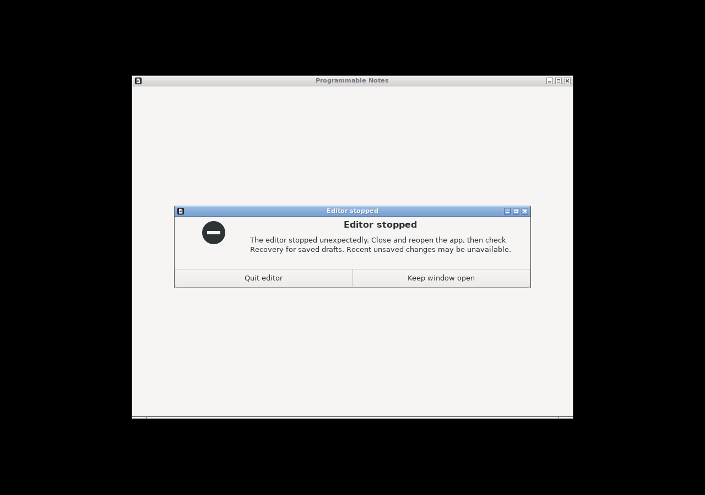

# Native editor termination, safe closing and recovery

The installed Linux editor could retain a blank window after its WebKit renderer
terminated. A stale frontend busy flag then blocked normal closing. This change
adds native recovery guidance and an explicit warned Quit action for actual
editor-renderer termination. It is a failure-handling improvement, not a fix for
the underlying JSC crash.



## Implementation and boundary

The callback is installed only for the trusted editor. Preview mode gains no
callback, dialog plugin, IPC or capability. Normal API termination is ignored.
The native signal invalidates frontend busy hints; actual Rust operation counts
still protect ordinary closing and the last dirty state still requires
confirmation. A real Operation-lifecycle Rust test covers healthy work, renderer
loss, late stale hints and native operation completion without clearing dirty data.

The notice shares the existing native dialog guard. A single background waiter
per failed window waits for any picker/confirmation to finish, then displays on
the main thread and retains the guard through dismissal. Existing authorization
flows are not cancelled automatically. Quit is an explicit force-quit after the
warning; existing atomic-write/recovery rules govern interrupted operations.
Keep leaves the window open with a functioning native close path. No automatic
reload, restoration or document write is added. Read ADR011 for tradeoffs.

## Reproductions and corrections

- Old ELFff7d4bab…: native dialog positive control passed. Its verified owned
  renderer45071 was killed, Root45039 survived, no Editor stopped notice appeared,
  and a native close attempt produced File operation in progress from stale
  client_busy. The probe exited1 and identity-checked cleanup terminated its Root.
- Intermediate unguarded ELF6e26da64…: a real picker was open when renderer45821
  died. After the trusted native signal, both picker and error notice were visible;
  the corrected probe failed the explicit overlap assertion. This intermediate
  package was never pushed or released.
- Earlier picker attempts hit a transient X BadWindow read and a test-helper
  undefined function. These are retained as observation errors, not application
  regressions or semantic overlap proof. The permanent helper was linted and uses
  bounded retries only for transient read failures; a failed query is never absence.
- Initial Rust trait import failed compilation and was corrected to the binding's
  exported WebViewExt. The successful build and its original failure are retained.
- Read-only review found no remaining Critical or Important issue after modal
  serialization. Its receipt-validation suggestion was applied consistently.

## Exact final package and executed checks

Debian SHA256
`7ad9debef5cbbfbebc30d030b3d5330c7d8df84d7660a134b0c191ab3a967f21`,
6,835,996 bytes; installed ELF
`837d2ab94a1b4e0004538da710bc2d7e9c32d203f106e93bce08032e8900865a`.
Optimized production inspection/install passed without security-test APIs.
All152 shipping source/config/lock/vendor/default-fixture files match the builder;
this is not a hermetic-build claim. The GTK version was already pinned in the
lock graph; only its Linux dependency category/explicit API feature changed.

Final full Node check exited0: formatting, lint, strict types, fresh build,
**98 unit and37 matching Chromium tests**. Current application Rust tests passed2.
The preceding clean checkout's39 ordinary document and7 policy tests retain their
unchanged-crate scope; no new infrastructure-only case is inferred here.

Actual ordinary Ubuntu24.04/WebKitGTK2.52.6 QEMU/Xvfb/Openbox tests, using the
documented software-rendering flags:

- Default native probe exited0. Healthy native dialog/busy-close positives passed;
  after verified renderer46282 death, Editor stopped appeared and explicit Quit
  exited Root46249 despite the stale frontend hint. The screenshot is actual GTK.
- Picker probe exited0. After renderer46491 died, the trusted native signal was
  observed while the real picker remained open and the notice stayed absent.
  Cancelling the picker released the queued notice; explicit Quit exited Root46459.
- Renderer-restart automatic recovery exited0. Two mixed-case opened buffers kept
  independent bounded snapshot histories and exact baselines/content. Renderer46736
  died while Root46705 survived. Keep window open, native dirty-close Cancel then
  explicit discard worked. New Root46863 discovered the records, restored an
  unsaved unbound buffer, handled Save As cancellation and acknowledged an exact
  separate `.MdX` copy. Original mode0640/bytes and new mode0600/bytes were checked.
  Every owned version was deleted and the new Root exited normally.
- Independent post-run checks verified literal original/copy bytes and hashes,
  permissions, absence of all four test Roots, and recovery limited to `.lock`.
- Independent IPC/security command exited0 on this ELF: editor positives,
  capability-denied preview document/recovery/preview commands, absent privileged
  plugins, real Counter2, parent DOM/storage and HTTP/file CSP denial. Normal
  supervised private networking, automation-off, NoNewPrivileges, effective fixed
  limits and Stop were verified separately from the direct ACL context.

The complete ordinary fidelity command also exited0 on this exact ELF with all
seven optional flags: real React, same-name independent buffers, dense fallback,
all modes, heading/paragraph/list/quote/multiline edits, mixed physical endings,
source navigation, exact disk/history/mode0640, dirty-close cancellation, real
restart, legacy restoration, invalid draft refusal and explicit deletion. An
independent post-run check verified all four expected fixture hashes/modes,
both Root absences and recovery cleanup. This successful run does not erase the
two earlier failures on ELFff7d4bab… or establish a JSC root-cause fix.

## Reproduce safely

Follow the X11/disposable full-system procedure in Linux desktop testing. The
retained administrator helper requires the exact expected installed ELF hash,
Root UID/path/start and a unique owned descendant WebKit process before SIGKILL.
Receipts are a trusted external-helper boundary, not cryptographic attestation.
Node checks their Root/hash, renderer path/PID/hash/UID and signal. The helper is
currently scoped to Ubuntu's synthetic ubuntu/UID1000 account; never point it at
personal data. Root PID comes from the trusted launch wrapper, not a name search.

Use a fresh fixture per mode and a second VM administrator terminal for the
paired kill helper. Run ordinary-user commands as documented:

```sh
NATIVE_DISPOSABLE_PROFILE=1 npm run native:renderer:test
NATIVE_DISPOSABLE_PROFILE=1 npm run native:renderer:test -- --picker
NATIVE_DISPOSABLE_PROFILE=1 node scripts/native-auto-recovery.mjs --renderer-restart
```

The recovery mode cannot be combined with other modes or whole-process crash
mode. Strict real subprocess tests first failed, then passed. These tests do not
simulate an in-flight file save at the kill point; they kill only after committed
snapshots. Existing interruption tests retain their separate scope.

## Remaining limitations

A live hung renderer has no termination signal. This does not recover transient
React state, recent uncommitted buffers, imported workspace graphs or power-loss
writes. Physical GPU/Wayland and other native platforms remain untested. A dedicated
unprivileged preview-WebProcess-kill negative is the next independent lifecycle
check; IPC and ordinary preview shutdown were verified here. Native
JSC/SIGSEGV/startup/blank and the older additional resident-page OOM gate remain
unresolved; earlier failures retain their exact binaries. No complete new hostile
resource matrix or production security-readiness claim. PR#1 stays draft, without
merge or public release. Hosted account billing still prevents CI jobs starting.
