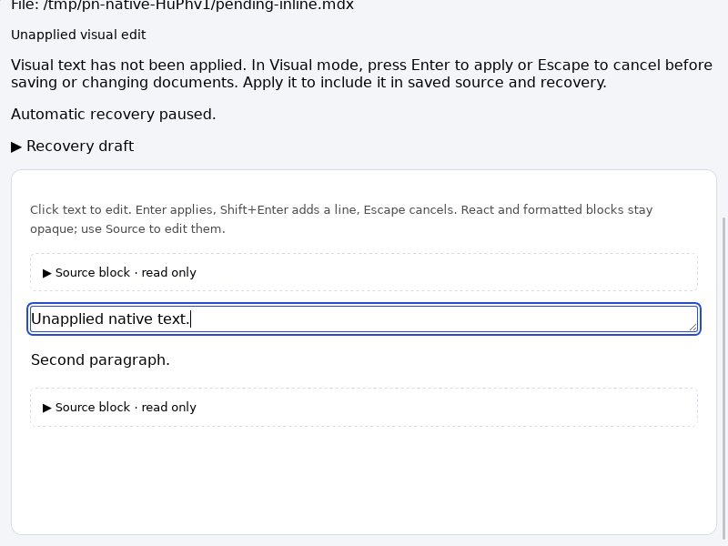
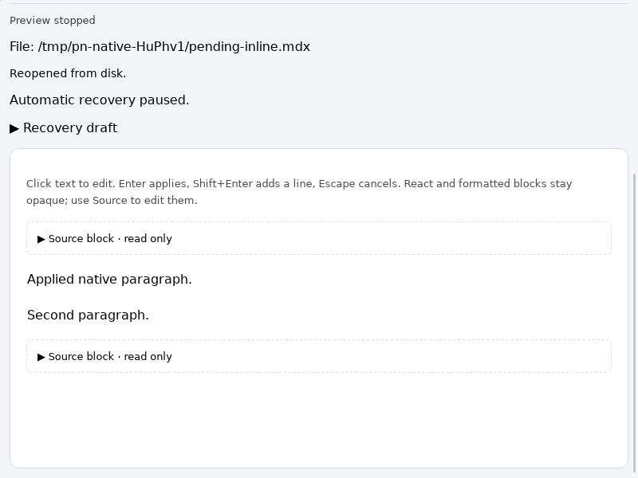

# Protect unapplied visual text

Base 3db7805. A real browser reproduction showed a data-loss issue: after typing
an inline value, the app still reported Source unchanged and Save exported the
older source; switching away and back removed the pending textarea entirely.
`raw/before-fix.json` and the two browser screenshots retain this synthetic case.
The browser regression then failed specifically because Save was enabled; a
separate unit regression failed because pending text did not mark the app dirty.

## Implemented boundary

Only the trusted Markdown editor reports pending text. While modified inline text
is unapplied, Save/Open/New/Close/Reopen, document selection and another inline
edit are blocked. Native/manual recovery restoration cannot replace the buffer;
controller-level operations also reject it if invoked despite disabled buttons.
Mode switching and source editing remain available. Enter still validates the
captured source and parser span before applying; Escape explicitly discards the
pending value. No preview message or React component receives edit or file access.

Pending text participates in browser unload and native dirty-close protection.
File operations disable inline input so a late picker/read response cannot discard
new inline typing. If source editing destroys the old visual mapping, a retained
textarea still exposes the exact pending value for copying/cancellation; Enter
still rejects the stale revision. The missing-mapping unit test failed before
that fallback and passed afterward. User text is not automatically interpreted as
source or written to disk. **Unapplied text is memory-only until Enter applies it**;
the visible note explains that saved source/recovery includes applied text.
Automatic snapshots of actual committed source continue independently; pending
text cannot disable snapshot protection for unrelated dirty buffers.

## Final regression results

Formatting, ESLint, strict TypeScript, 50 unit and 24 Chromium tests passed.
Browser assertions include blocked replacement/save, mode retention, exact
BOM/CRLF/JSX download, cancellation, switching, undo, and a disappeared mapping:
the pending value remains available, stale Enter is rejected, and cancellation
unblocks the source without overwriting its syntax error.

The same installed package passed the native IPC suite: registered commands and
all recovery actions denied from preview, absent filesystem/shell/HTTP plugins,
private profile and network namespace, effective cgroup policy, Stop, Counter 2,
parent DOM/storage isolation, and actual HTTP/file CSP denial. The ACL probe uses
an automation-attached child that changes WebKit networking; ordinary production
namespace/automation observations were made separately. This is not a fresh full
CPU/OOM/expiry/crash matrix pass.

## Actual optimized native package

The corrected production package was built, installed and tested in the existing
disposable Ubuntu 24.04.5/WebKitGTK 2.52.6/QEMU TCG/Xvfb desktop. Supported software
rendering only; no security-test feature, permission or sandbox change.

- Debian SHA-256: `c5bc054d4f5ac4978ba1a88b78cf079bc1177afa349b57edffaf3cd4da80a997`.
- Installed ELF SHA-256: `fef45d851278691bb826e9390d5bc550c8568bb574fb6b05b3f88fe59eb29a40`.
- Builder/application-source hashes matched the checkout (`raw/source.sha256`).

The runner opened a synthetic BOM/CRLF/Unicode/JSX document with mode 0640. Actual
inline keyboard input disabled destructive document actions, left disk unchanged,
and caused a real WM window-close request to show the native Unsaved source
confirmation. **Cancel** retained the exact pending value and original file.
Source/Visual switching retained it; Escape cancelled without writing. Applying
another edit, Save, Undo/Save, Redo/Save, Reopen and clean process exit all passed.
Every saved byte and mode 0640 were checked. Automatic recovery was explicitly
paused for this input test; no records were created/deleted. Preview was stopped,
so this functional runner does not claim React/resource/security validation.

Reproduce with the installed package, external driver, disposable empty profile
and fresh fixture env as described in [Linux testing](../../LINUX_DESKTOP_TESTING.md):

```sh
NATIVE_DISPOSABLE_PROFILE=1 node scripts/native-pending-edit.mjs
```

The native screenshots are captured editor webviews; typing scrolls the focused
textarea into view. They are synthetic acceptance evidence, not full-desktop GPU
or Wayland captures.





## Scope and additional observation

No aesthetics, arbitrary JSX reverse editing, native capability or recovery format
changed. Pending text is not crash-durable before apply. Earlier intermittent
blank-preview startup/recovery and hosted account-billing blocks remain open.
Read-only review found no important issue.

Two initial browser-fixture attempts exposed another existing mapping limitation:
ordinary BOM-prefixed Markdown has parser positions shifted by the stripped BOM
and falls back to opaque blocks. The proper guard regression uses the already
supported BOM metadata fixture and retains exact BOM/CRLF/JSX byte assertions;
the actual loss reproduction uses plain CRLF. BOM mapping is queued as a separate
correctness fix, rather than bundling it into this guard.
