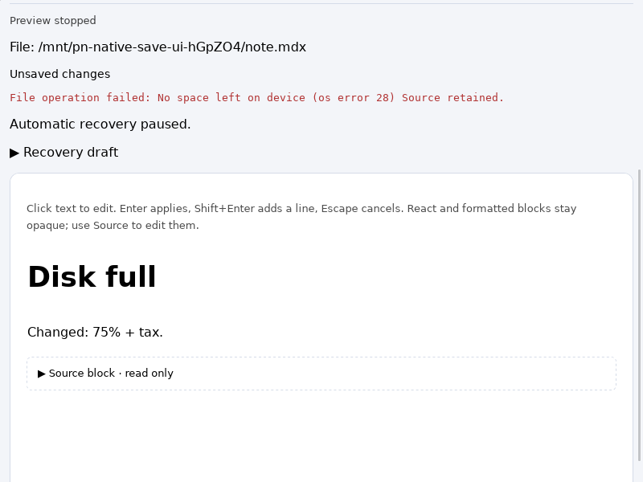

# Actual packaged editor Save with real ENOSPC

The restored disposable Ubuntu24.04/WebKitGTK desktop ran the unchanged production
ELF `a6d00cbb00a6acbbaaf6da9566a1f992b38f384df7d9b1c6878d9463334b1195`
as its ordinary user with no JIT/sandbox/quota changes. This is actual optimized
application UI acceptance, distinct from the standalone Store syscall tests.

An OS picker authorized one synthetic `.mdx` on a new private2MB tmpfs. The
editor-owned Visual surface applied a literal paragraph patch. An external
**bounded** filler then encountered real kernel ENOSPC on that filesystem.
Explicit Save produced a visible error ending **Source retained** and kept the
Unsaved changes indicator, exact original BOM/UTF8/CRLF bytes, mode0640, sibling,
and pending rendered text. Undo/Redo remained usable without writing the file.

After freeing only the synthetic filler, explicit Save cleared the error and
wrote exact expected MDX. Reopen positively acknowledged disk loading and retained
those exact bytes/mode/sibling. Real window close exited the Root. The final MDX
and screenshot are retained alongside a hash-bound structured report. Preview was
stopped; this is not a repeated malicious-code/IPC/resource matrix. No production
application code or permissions changed.



## Safety and failed observation

The new external guard is read-only: explicit canonical owned private empty
mountpoint, unique whole-filesystem tmpfs root in mountinfo, distinct parent
device and1–4MB capacity. It rejects subtree/stacked ambiguity before creating
fixtures. The filler cannot write more than its verified tiny capacity plus one
block even if it fails to encounter ENOSPC. Actual escaped-space mount acceptance
and real subtree-bind refusal passed, leaving an external synthetic sentinel
unchanged. Ordinary-directory/symlink refusal tests pass without creating files.

Failure cleanup binds a Linux pidfd, then verifies UID/start tick/executable hash
before SIGTERM through that descriptor. There is no numeric-PID signaling fallback.
Only owned synthetic filler is removed; final fixture data is captured outside
the full filesystem before the controller unmounts its disposable mount.

The first observer failed **before applying the edit or filling storage**: an
immediate read after xdotool typing observed `C`. It was not a Save failure. The
next independent command added a bounded wait for the **complete exact** input
before keeping the same assertion and applying Enter. That command passed all
gates; it does not convert the first failed command into a pass. Exact first
observer source was reconstructed and verified against its recorded SHA256 before
retention. Read-only review found no Critical/Important issue; it did not rerun
the GUI. No engine defect was inferred or hidden by this observer correction.

## Reproduce

Use the installed-app external driver and disposable profile procedure in
[Linux testing](../../LINUX_DESKTOP_TESTING.md). Prepare a separate empty tiny
mount as administrator, owned by the ordinary desktop test user:

```sh
pn_small_fs=$(mktemp -d /tmp/pn-native-save-XXXXXX)
sudo mount -t tmpfs -o "size=2M,uid=$(id -u),gid=$(id -g),mode=0700" tmpfs "$pn_small_fs"
trap 'sudo umount "$pn_small_fs"; rmdir "$pn_small_fs"' EXIT
pn_env=$(NATIVE_INSTALLED_BINARY=/usr/bin/programmable-notes node scripts/native-test-setup.mjs)
. "$pn_env"
NATIVE_DISPOSABLE_PROFILE=1 NATIVE_SAVE_ENOSPC_DIR="$pn_small_fs" \
  timeout -k 5s 240s npm run native:save-enospc:test
```

Do not use personal files or shared `/dev/shm`. The test creates files exclusively
and refuses a nonempty mount. Copy its evidence before unmounting; data on the
throwaway tmpfs is intentionally ephemeral. Ordinary hosted CI exercises the guard
refusal controls and standalone ENOSPC gate; it does not claim this native GUI
command ran on a standard Actions runner.
